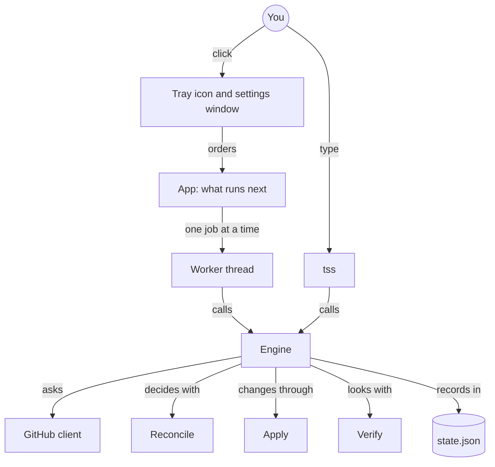
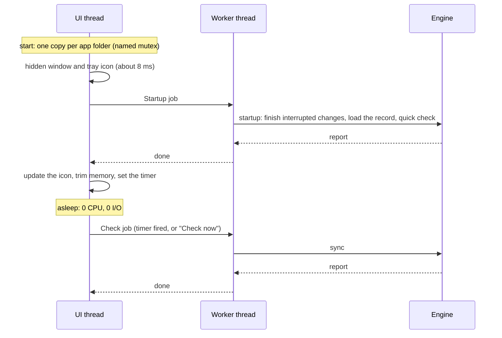
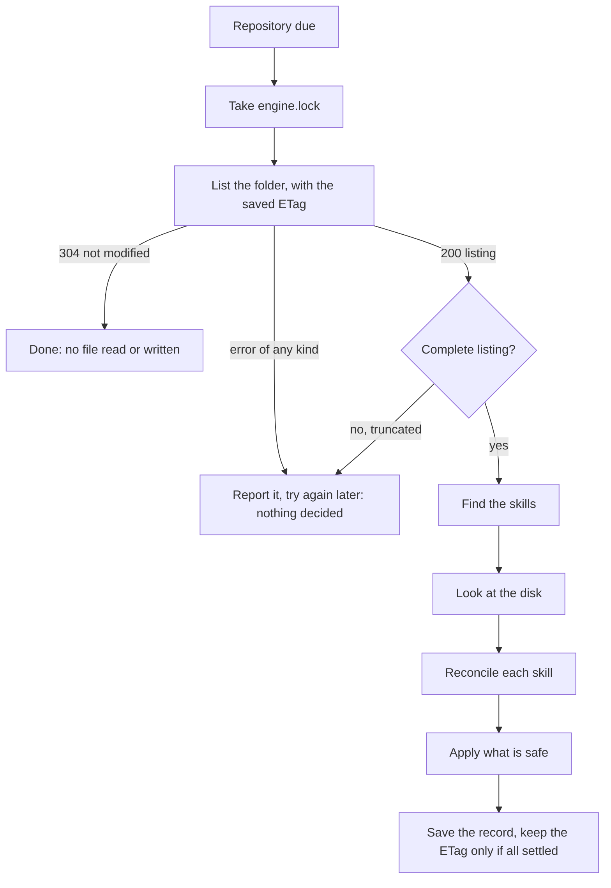
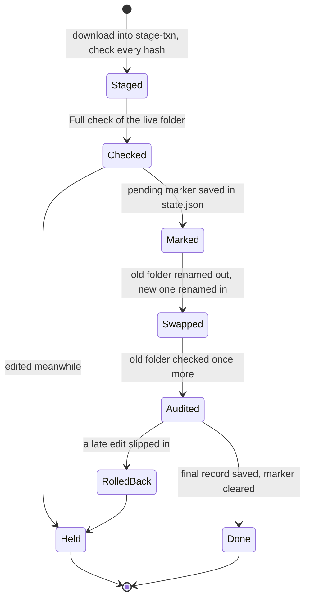
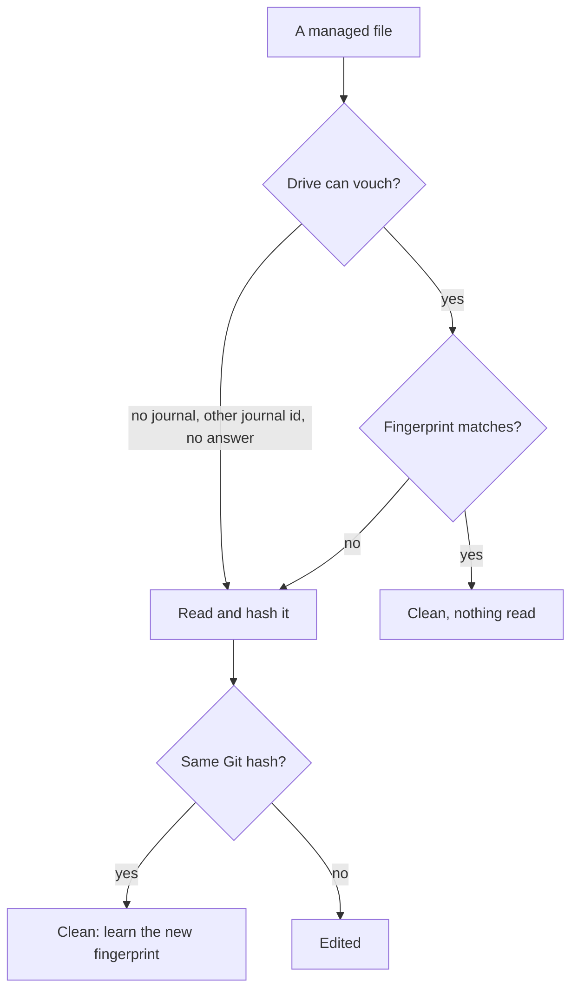
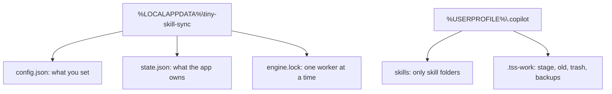

# Architecture

How tiny-skill-sync works inside. For what it does and how to use it, see [README.md](README.md). For building and
testing, see [CONTRIBUTING.md](CONTRIBUTING.md).

## The big picture

There are two programs, built from one Rust library:

- `tiny-skill-sync.exe`, the tray app. It runs all the time and checks on a schedule.
- `tss.exe`, the command line. It does one thing and exits.

Both drive the same **engine**, so every safety rule is the same in both. The engine owns no window, timer or thread;
it is called, does one piece of work, and returns a report.

The code is split so that **the decisions are pure functions** (no disk, no network, no clock) and can be tested
case by case. Code that talks to Windows is kept in `src\win\`.

| Module | Job | Pure? |
| --- | --- | --- |
| `config` | `config.json`: the repositories, their intervals, the skills folder. | yes |
| `tree` | Reads a GitHub tree listing and decides which folders are skills. | yes |
| `pathsafe` | Rules for names and paths that come from GitHub (no `..`, no `CON`, no case clashes, length). | yes |
| `reconcile` | The decision table: given upstream, the record and the disk, what may be done to each skill? | yes |
| `scheduler` | When is each repository due; how long to wait after a failure. | yes |
| `interval` | `30m`, `6h`, `1d`, `2w`, `1mo` and calendar-month arithmetic. | yes |
| `board` | What the tray and the settings window say: one line per repository and per skill, and the buttons. | yes |
| `app` | The tray app without its windows: which job runs next and when to wake up. | yes |
| `state` | `state.json`, the ownership record: what the app installed, file by file. | file I/O |
| `verify` | Is a skill folder on disk still exactly what was installed? | file I/O |
| `apply` | The only module that moves or deletes anything in the skills folder. | file I/O |
| `engine` | Puts it together: lock, load, ask GitHub, reconcile, apply, save. | uses all |
| `github` | Three kinds of request: list a folder, pin the commit, download a file. | network |
| `hash` | SHA-1 and Git blob hashes, in plain Rust. | yes |
| `cli` | `tss`. | uses engine |
| `win::fs` | File facts `std` does not give: file id, USN, volume, links; one-handle folder listing. | Windows |
| `win::http` | A small blocking HTTP client on WinHTTP. The only networking code. | Windows |
| `win::cred`, `win::proc` | The token from Credential Manager, or from `gh auth token`. | Windows |
| `win::ui` | The tray icon, the settings window, questions, and the small control layer they are built from. | Windows |

## Threads and waking up

The tray app has two threads.

- The **UI thread** owns the hidden main window, the tray icon, the settings window and the message loop. It sleeps in
  `MsgWaitForMultipleObjectsEx` on window messages and three handles: a waitable timer set to the next check, a change
  notification on the app's folder (`config.json`, `state.json`), and one on the skills folder. Nothing polls.
- The **worker thread** owns the engine and runs one job at a time: the start-up look, a check, a resolution. Network
  calls, hashing and file changes never run on the UI thread.

Timed checks run in Windows' background mode (low I/O and CPU priority); the start-up look and checks you ask for run
at normal priority. After the start-up job, after a timed check and when the settings window closes, the app trims its
working set so it holds about 1 MiB while idle.

`app.rs` guards against busy loops whatever the engine answers: a job that could not run at all is retried after
5 minutes, doubling up to an hour; a job that found `tss` working is retried after a minute; two timed checks are at
least 30 seconds apart; and after the computer wakes from sleep, the app waits 30 seconds for the network.

A change in the skills folder only leads to a read-only look, two seconds after the last change, so the settings
window shows an edit without waiting for the next check. Safety never depends on it: every change starts by comparing
the disk with the record.

## A check

- **One request when nothing changed.** The app lists the configured folder with
  `GET /repos/OWNER/NAME/git/trees/BRANCH:FOLDER?recursive=1` and sends the ETag it saved last time. GitHub answers
  `304 Not Modified` with no body when nothing in that folder changed, even if other parts of the repository did.
- **Downloads are pinned.** When something changed, the app reads the commit the branch points at and downloads each
  needed file from `raw.githubusercontent.com` at that commit. Every file is checked against the Git blob hash in the
  listing. If the branch moved during the download, a hash does not match, nothing is installed, and the check is
  tried again a minute later.
- **The ETag is kept only when everything settled.** If anything was held, failed or was cancelled, the next check
  lists again instead of getting a 304, so unfinished work is never forgotten.
- **`gh` is only a token source.** All requests are made by the app's own WinHTTP client.

## Deciding: the reconcile table

`reconcile.rs` turns three facts about each skill into a verdict: what upstream lists, what the record says the app
owns, and what is on disk. It is a pure function; every row below is a test.

| Upstream | Record | Disk | Verdict |
| --- | --- | --- | --- |
| has it | not owned | no folder | **Install** |
| has it | not owned | a folder, identical | **Adopt** (record it as owned, change nothing) |
| has it | not owned | a folder, different | **Hold**: it may be yours |
| has it, same | owned | clean | In sync |
| has it, changed | owned | clean | **Update** |
| has it, same | owned | edited or deleted | Report only |
| has it, changed | owned | edited or deleted | **Hold** |
| gone | owned | clean | **Delete** |
| gone | owned | edited | **Hold** |
| gone | owned | no folder | Forget it |
| rejected (unsafe) | any | any | Leave it untouched, report why |
| any | owned by another repository | any | Skip: a name clash |
| any | "keep mine" | any | Skip |

Extra files in an owned folder count as an edit. If a listing has no skills at all while some are owned, every delete
is held until you confirm (the **mass-deletion guard**): an empty listing is more often a mistake than a real removal.

**A failure never reaches this table.** `github::FailureKind` separates authentication, not found, rate limited, server
error, redirect, protocol, network, too large, cancelled, changed during download and local errors. Any of them ends
the check of that repository before anything is decided.

## Changing the skills folder

`apply.rs` is the only code that moves or deletes anything in the skills folder. An update goes like this:

- The work folder (`.tss-work`) sits **beside** the skills folder, on the same drive. Copilot never sees a half-made
  skill, and the renames are atomic.
- The swap uses renames, so the skills folder never holds half a skill.
- A delete is the same without the download: Full check, marker, rename to `trash-txn`, audit, remove.
- **A folder is deleted only after it was proven to equal a version the app installed.** Anything else is kept as
  `backup-<skill>-<txn>` in the work folder, and backups are never deleted automatically.
- If the app or the computer stops between two steps, `recover` reads the pending marker at the next start and
  finishes or undoes the change. Tests stop the code at every step to prove it (`engine_lifecycle`, `apply` tests).

## Finding edits: quick and full checks

`verify.rs` has two strengths.

- The **fingerprint** is what Windows reports for a file through one handle: file id, size, last-write time, change
  time and the NTFS **USN** (update sequence number). The USN moves on every content change, even when the size and all
  the times are put back, so the quick check finds edits made while the app was not running. The app never reads the
  journal's history, so a journal that wrapped around cannot hide an edit; a re-created journal has a new id, and then
  nothing is trusted.
- The **quick check** is used for status: start-up, a look after the folder changed, and before deciding. When every
  fingerprint matches, it reads no file contents at all.
- The **full check** reads and hashes every file. It runs before any update or delete, because a write through a
  memory-mapped view that was not flushed yet does not move the USN.
- A file that changes while it is being checked counts as edited. When in doubt, a file is edited, never clean.
- Each skill folder is opened once without following links, and listed through that same handle
  (`win::fs::Folder`, `GetFileInformationByHandleEx`). The first query restarts the listing, so asking twice gives the
  same answer, and "not found" means an empty folder only on that first query; later it is an error, never a complete
  listing. Subfolders are opened by their path, again without following a link at the end of the path, so a folder
  replaced by a link is reported, never followed. A listing only reads names; if a folder higher up is swapped for a
  link while it runs, the names may come from the link's target (a known limit of opening by path).

The evidence for this design, including the spikes that measured it, is in [spikes/README.md](spikes/README.md) and the
tests in `tests\downtime.rs`.

## Scheduling

`scheduler.rs` is pure: the time is passed in.

- A repository that was never checked is due now; otherwise one interval after its last successful check (so
  restarting the app causes no extra requests).
- After a failure: 5 minutes, then 10, 20, 40 and so on, never later than the repository's own interval. A rate limit
  waits for the time GitHub named.
- Nothing runs more often than every 5 minutes. A month is a calendar month, clamped to the end of a shorter month.
- A last-check time in the future (the clock was set back) counts as now.
- The tray re-plans the timer when the clock changes (`WM_TIMECHANGE`) and when the computer wakes from sleep.

## Files on disk

- `config.json` is meant to be read and edited by hand. The tray reloads it when it changes.
- `state.json` holds, per repository: the ETag of the last fully applied listing, the last check time, the "keep mine"
  list, and per owned skill its commit, its files (path, Git blob hash, size, fingerprint) and an optional pending
  marker. It is written only when something changed, through a temporary file and a rename. A damaged one is kept as
  `state.json.damaged-*`; one written by a newer version is not touched.
- `engine.lock` stops the tray and `tss` from working at the same time; the loser is told to try again.
- The app keeps nothing inside the skills folder, so Copilot only ever sees skill folders.

## The tray and the settings window

`board.rs` turns the engine's reports into what you see: a level per skill (fine, needs attention, error), a line of
text, and the buttons that make sense. It is pure, so every sentence and button is tested. The newest news about a
skill wins; a failed check or a 304 says nothing new about the skills, so the last real rows stay.

The windows (`src\win\ui\`) are plain Win32 controls (common controls 6, through the manifest), with no dialog templates
and no COM. They are built from a small reusable control layer in `src\win\ui\mod.rs` (`Form` and helpers for labels,
buttons, check boxes, edit boxes, combo boxes and list views, scaled for the screen's DPI). The settings window is
created when opened and destroyed when closed, so it costs nothing while closed.

A window procedure can be entered again while it runs (a control notifies its parent from inside the call that changed
it). So the UI state lives in thread-local `RefCell`s borrowed only with `try_borrow_mut`, and no borrow is held across a
call that runs a message loop (a question, the tray menu, `DestroyWindow`).

## Measuring

When `TSS_BENCH_REPORT` names a file, the tray app appends timing marks to it (`src\win\ui\bench.rs`): the tray icon
shown, each finished job (with how long it took), the settings window painted, quit and exit. `scripts\bench.ps1` reads
the marks together with Windows' process counters and compares them with the budgets. Without the variable, nothing is
written.

## Where to change what

| To change... | Look in |
| --- | --- |
| Which folders count as skills | `tree.rs` |
| What is installed, updated, deleted or held | `reconcile.rs` (and its tests first) |
| How a change is made on disk | `apply.rs` |
| How edits are found | `verify.rs`, `win\fs.rs` |
| Requests to GitHub | `github.rs`, `win\http.rs` |
| When checks happen | `scheduler.rs`, `app.rs` |
| What the user reads | `board.rs` (tray and settings), `cli.rs` (`tss`) |
| The windows | `win\ui\settings.rs`, `win\ui\tray.rs`, `win\ui\dialogs.rs`, controls in `win\ui\mod.rs` |
