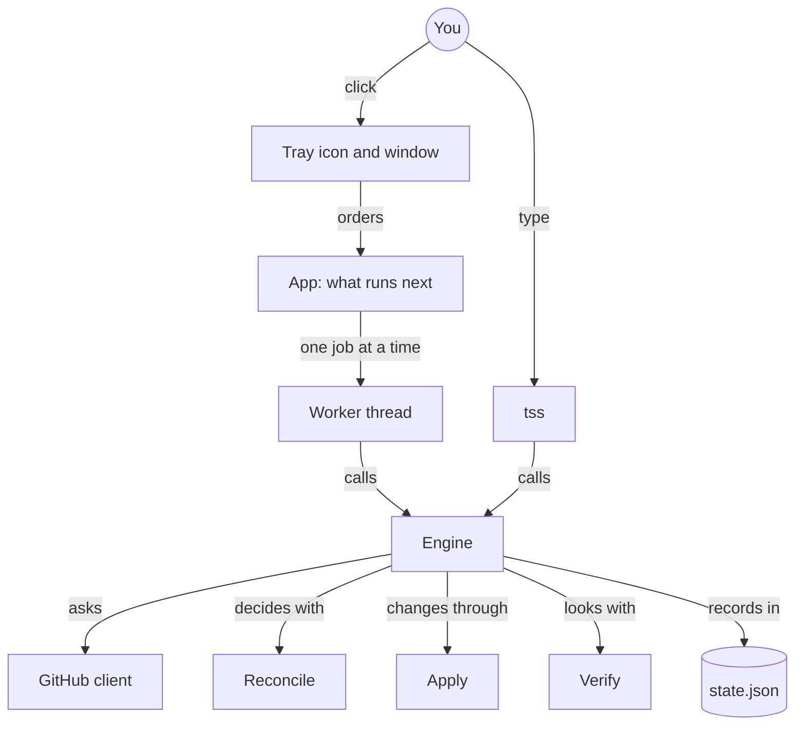
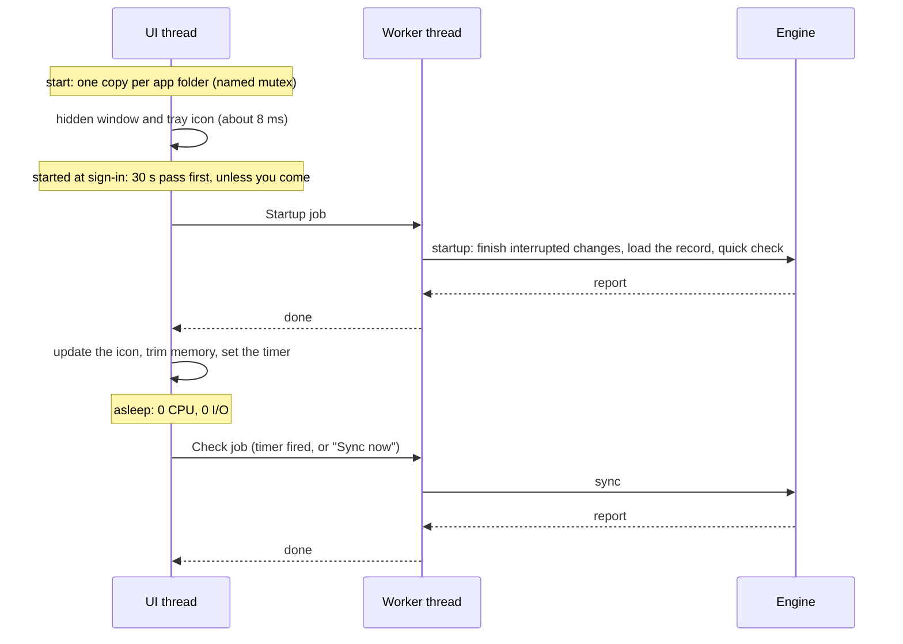
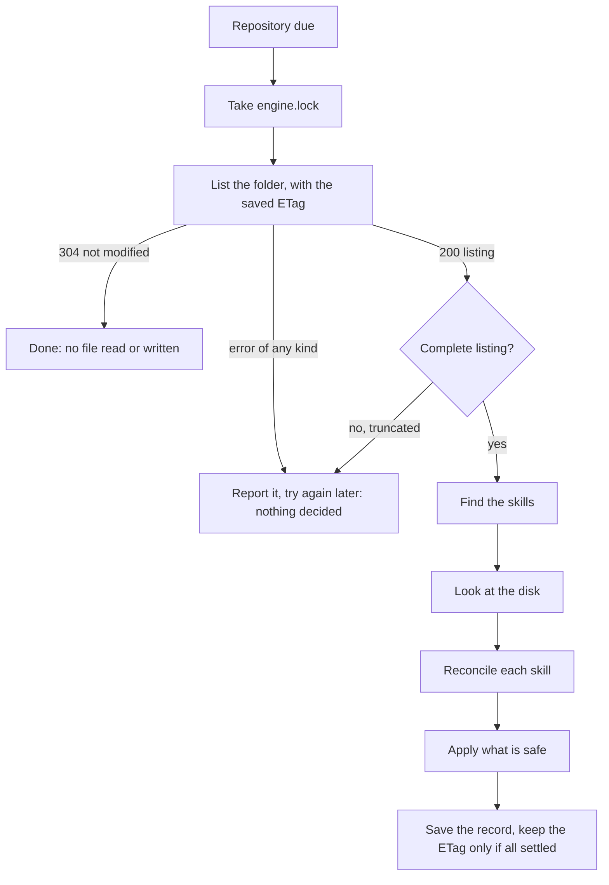
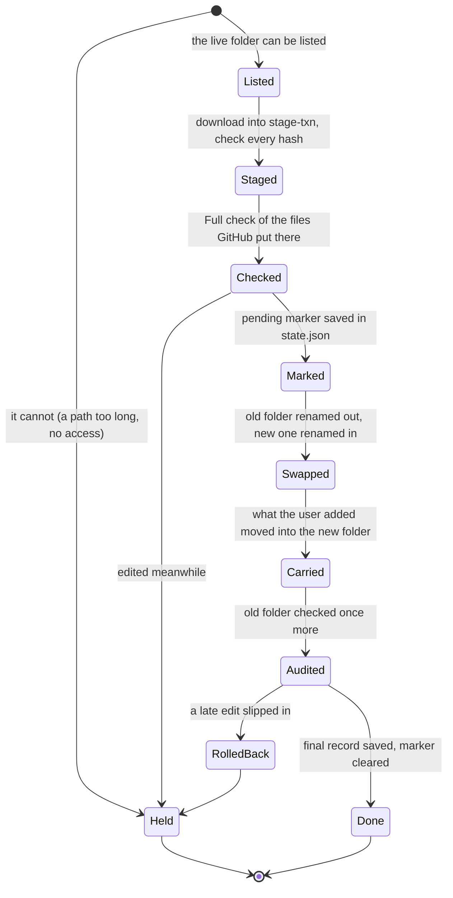
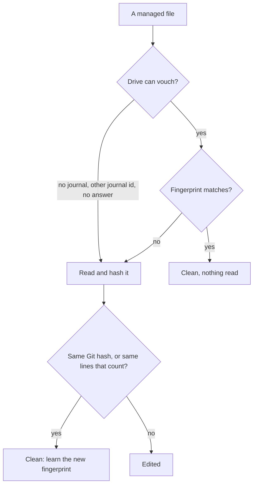
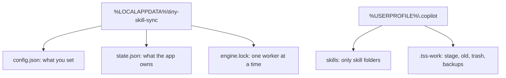

# Architecture

How tiny-skill-sync works inside. For what it does and how to use it, see [README.md](README.md). For building and
testing, see [CONTRIBUTING.md](CONTRIBUTING.md).

## The big picture

There are two programs, built from one Rust library:

- `tiny-skill-sync.exe`, the tray app. It runs all the time and checks on a schedule.
- `tss.exe`, the command line. It does one thing and exits.

Both drive the same **engine**, so every safety rule is the same in both. The engine owns no window, timer or thread;
it is called, does one piece of work, and returns a report.

The code is split so that **the decisions are pure functions** (no disk, no network, no clock) and can be tested
case by case. Code that talks to Windows is kept in `src\win\`.

| Module | Job | Pure? |
| --- | --- | --- |
| `config` | `config.json`: the repositories, their intervals, the skills folder. | yes |
| `tree` | Reads a GitHub tree listing and decides which folders are skills. | yes |
| `pathsafe` | Rules for names and paths that come from GitHub (no `..`, no `CON`, no case clashes, length). | yes |
| `reconcile` | The decision table: given upstream, the record and the disk, what may be done to each skill? | yes |
| `scheduler` | When is each repository due; how long to wait after a failure. | yes |
| `interval` | `30m`, `6h`, `1d`, `2w`, `1mo` and calendar-month arithmetic. | yes |
| `board` | What the tray and the window say: one line per repository and per skill, and the buttons. | yes |
| `app` | The tray app without its windows: which job runs next and when to wake up. | yes |
| `autostart` | Start with Windows: what the startup entry says, what it means, and which registry keys may be written. | yes |
| `diff` | What is different between the GitHub copy of a skill and the copy on disk, line by line ("Show changes"). | yes |
| `text` | When two copies of a file are the same: line endings, the line break at the end and blank lines don't count. | yes |
| `state` | `state.json`, the ownership record: what the app installed, file by file. | file I/O |
| `verify` | Is a skill folder on disk still what was installed? | file I/O |
| `apply` | The only module that moves or deletes anything in the skills folder. | file I/O |
| `engine` | Puts it together: lock, load, ask GitHub, reconcile, apply, save. | uses all |
| `github` | List a folder, pin the commit, download a file, page through path history and read complete historical subtrees. | network |
| `hash` | SHA-1 and Git blob hashes, in plain Rust. | yes |
| `cli` | `tss`. | uses engine |
| `win::fs` | File facts `std` does not give: file id, USN, volume, links; one-handle folder listing. | Windows |
| `win::http` | A small blocking HTTP client on WinHTTP. The only networking code. | Windows |
| `win::cred`, `win::proc` | The token from Credential Manager, or from `gh auth token`. | Windows |
| `win::autorun` | The startup entry in the registry: read, written and deleted only when the user asks. | Windows |
| `win::ui` | The tray icon, the window, questions, and the controls they are drawn with (see [below](#the-tray-and-the-window)). | Windows |

## Threads and waking up

The tray app has two threads.

- The **UI thread** owns the hidden main window, the tray icon, the window you open and the message loop. It sleeps in
  `MsgWaitForMultipleObjectsEx` on window messages and three handles: a waitable timer set to the next check, a change
  notification on the app's folder (`config.json`, `state.json`), and one on the skills folder. Nothing polls.
- The **worker thread** owns the engine and runs one job at a time: the start-up look, a check, a resolution. Network
  calls, hashing and file changes never run on the UI thread.

Timed checks run in Windows' background mode (low I/O and CPU priority); the start-up look and checks you ask for run
at normal priority, except the start-up look after a start at sign-in (below). After the start-up job, after a timed
check and when the window closes, the app trims its working set so it holds about 1 MiB while idle.

`app.rs` guards against busy loops whatever the engine answers: a job that could not run at all is retried after
5 minutes, doubling up to an hour; a job that found `tss` working is retried after a minute; two timed checks are at
least 30 seconds apart; and after the computer wakes from sleep, the app waits 30 seconds for the network.

Started by Windows at sign-in (`--background`, see [Start with Windows](#start-with-windows)), the app shows its icon
and then does nothing for 30 seconds (`SIGN_IN_GRACE`), so that Windows can finish starting and the network can come
up: the start-up job is taken off the queue (`App::started_by_windows`) and the timer queues it when the time is up.
It then runs in background mode, followed by the check of any repository that is due. Meanwhile the icon is a blue
ring with the tooltip "waiting for Windows to finish starting" (`Health::Waiting`). Someone coming ends the wait:
opening the window, or any job they ask for, queues the start-up job at once at normal priority (`App::user_here`);
timed checks still wait for the 30 seconds. A look the skills folder's notification asks for during the wait is
dropped, because the start-up job looks anyway.

A change in the skills folder only leads to a read-only look, two seconds after the last change, so the window shows
an edit without waiting for the next check. Safety never depends on it: every change starts by comparing
the disk with the record. Settings that name another skills folder lead to a start-up job instead, retried like the
first one, so the change of folder is recorded and reported at once (see [Files on disk](#files-on-disk)).

## A check

- **One request when nothing changed.** The app lists the configured folder with
  `GET /repos/OWNER/NAME/git/trees/BRANCH:FOLDER?recursive=1` and sends the ETag it saved last time. GitHub answers
  `304 Not Modified` with no body when nothing in that folder changed, even if other parts of the repository did.
- **Downloads are pinned.** When something changed, the app reads the commit the branch points at and downloads each
  needed file from `raw.githubusercontent.com` at that commit. Every file is checked against the Git blob hash in the
  listing. If the branch moved during the download, a hash does not match, nothing is installed, and the check is
  tried again a minute later. A file the listing names that is not found at that commit (a push landed between the
  two reads, or GitHub answered them from caches of different ages) is the same kind of failure (`Changed`, in
  `engine.rs`, `missing_means_changed`), for a check, **Show changes** and an overwrite alike: it never reads as a
  missing or private repository.
- **The ETag is kept only when everything settled or a completed/paused comparison is recorded.** If other work was held, failed or was cancelled, the next check
  lists again instead of getting a 304, so unfinished work is never forgotten. Historical comparison evidence is
  checked before reusing a comparison: a changed relevant local path or source requires a fresh listing. A choice about a skill drops the ETag
  too. The tray checks such a repository once in each run, as soon as it sees it (see [Scheduling](#scheduling)). A
  304 says nothing new about the skills, so its report carries over what the record knew: a repository whose last
  listing had no skills still reports so.
- **The token is sent only when it is needed** (`engine.rs`, `list`). A repository is listed without a token first, so
  a public one never makes the app look for one. When GitHub answers "not found" (it may be private) or the limit for
  anonymous requests is reached, it is listed once more with the token. A repository found to be private this way is
  remembered in the record (`needs_token`), so later checks send the token at once, until it can be read without one
  again. `use_token` in the settings sends it from the first request. Without a token, the failure is reported with
  what to do; as with every failure, nothing is decided from it.
- **`gh` is only a token source.** All requests are made by the app's own WinHTTP client.

## Deciding: the reconcile table

`reconcile.rs` turns three facts about each skill into a verdict: what upstream lists, what the record says the app
owns, and what is on disk. It is a pure function; every row below is a test.

| Upstream | Record | Disk | Verdict |
| --- | --- | --- | --- |
| has it | not owned | no folder | **Install** |
| has it | not owned | a folder holding every upstream file, the same | **Adopt** (record it as owned, change nothing) |
| has it | not owned | every file of one whole historical version matches | **Adopt historical**, then **Update** |
| has it | not owned | history search still active or paused | Hold only this skill; show search controls |
| has it | not owned | a folder, different | **Hold**: it may be yours |
| has it, same | owned | clean | In sync |
| has it, changed | owned | clean | **Update** |
| has it, same | owned | edited or deleted | Report only |
| has it, changed | owned | edited or deleted | **Hold** |
| gone | owned | clean | **Delete** |
| gone | owned | edited | **Hold** |
| gone | owned | no folder | Forget it |
| rejected (unsafe) | any | any | Leave it untouched, report why |
| any | owned by another repository | any | Skip: a name clash |
| any | "keep mine" | any | Skip |

**What the user added is theirs.** A skill folder the record does not own is adopted only when every file in the
current upstream version, or in one single past version from the configured branch's history, is present and the
same under the existing text comparison rules. A folder matching a past version may then be updated automatically;
otherwise it is held. A file the user added to a skill is never changed, deleted, reported or shown: an update or a
removal moves it along (`carry`), and when GitHub adds a file with the same name, the user's goes to `backup-*`.
An edit means a file GitHub put there was changed or deleted. If a
listing has no skills at all while some are owned, every delete is held until you confirm (the **mass-deletion
guard**): an empty listing is more often a mistake than a real removal.

"Identical", "same" and "clean" all mean the same as `text.rs` says: two copies of a text file are the same when only
their line endings, the line break at the end or blank lines differ. That holds for adopting a folder, for finding
edits, and for the proof `apply.rs` needs before it replaces or deletes a folder. Downloads are still checked byte for
byte against the Git blob hash.

**A failure never reaches this table.** `github::FailureKind` separates authentication, not found, rate limited, server
error, redirect, protocol, network, too large, cancelled, changed during download and local errors. Any of them ends
the check of that repository before anything is decided.

### Recognising older copies

`compare_unmanaged` compares the current version first. For a different copy, `Remote::history` requests commits
touching that skill's path, pinned to the configured branch's commit, in pages of 100. The pin's configured tree must
match the current listing. `Remote::historical_tree` walks complete parent trees and reads the skill subtree:
missing paths must be proven by a parent listing, never inferred from a 404. Truncated, malformed or unsafe trees
and failed downloads abort the repository before reconciliation. Downloads still prove their Git blob hashes.

The quick budget is **eight historical candidates per repository check**, shared across its unowned skills.
Remaining candidates continue in the same bounded slices, at least 30 seconds apart, on the existing worker. It is
not a total-depth limit: pages continue until a whole version matches or the actual history is exhausted. An active
slice is work, not an unchanged poll. A comparison that reaches the download limit is an error, never a no-match.
User resolutions run before queued checks; the shell cancels an ongoing check with a flag belonging to that order
alone, so cancellation before starting or just after finishing cannot cancel the following resolution.

`RepoState::searches` saves the source, current tree, pin, page/cursor, candidates checked, pause/completion flags,
volume/journal identity and local evidence for the union of paths actually compared. File fingerprints include the
USN; missing paths are probed again through `Spots`, including their parent paths. This detects repairs and nested
edits without reading unrelated extras. Without a trusted journal, content hashes are used instead. Root changes
follow the ordinary set-aside records. Source/tree changes or invalid evidence restart comparisons; none of this
cached evidence authorizes a file change. Completed/paused unchanged polls make one branch-commit request and
write nothing; last-check times remain lazy. Failures are not cached as no-match, and active-search retry times
survive restart. Pauses persist until Resume, even across a source change.
The eight-candidate quick budget took 11.4 seconds in the live unmanaged fixture check, including the initial
install and an older-copy update. It bounds candidates, not wall time; network latency still varies. The worker
checks cancellation before swapping a staged version, and retains the search until a historical update succeeds,
so a late Cancel can still pause the already adopted old baseline without losing its proof.

The branch-commit probe is needed even when the current tree is unchanged: a push followed by a revert can add a
matching past version without changing the tree's ETag. Ordinary owned-only polls still use the conditional tree
request. Both unchanged paths cost one request, zero file content reads and zero writes on NTFS.

Only a full matching version creates `UnmanagedState::Historical` and the distinct pure
`Verdict::AdoptHistorical`. The context keeps that old version and its text proof. `Applier::adopt` fully rechecks and
records **the old baseline**, then the ordinary update transaction stages the current version and rechecks again.
A stop after adoption leaves a valid owned old baseline. No unconditional backup is made; extras and collision
backups use the normal carry/recovery path. UI, CLI and Activity report historical update success only when apply
succeeds. Force/keep remove or supersede saved searches; no queued continuation has independent installation authority.

## Changing the skills folder

`apply.rs` is the only code that moves or deletes anything in the skills folder. An update goes like this:

- The work folder (`.tss-work`) sits **beside** the skills folder, on the same drive. Copilot never sees a half-made
  skill, and the renames are atomic.
- The swap uses renames, so the skills folder never holds half a skill.
- **What the user added moves with the skill.** After the swap, `carry` moves every entry of the old folder that the
  old version did not list into the new folder, one at a time and never replacing anything. Something in the way of a
  file of the new version (the user's file of the same name) stays in the old folder, which then becomes a backup.
  `carry` returns those paths, so an update says `Applied::Displaced` and the engine adds a warning naming them and
  the backup (Activity shows it, and so does `tss`); a recovery that finishes such an update says the same in its
  note. An overwrite says nothing of its own, because it keeps the whole old folder and `resolve` reports that backup.
  A folder that cannot be listed (with Windows long paths off, one of the user's whose path is over 260 characters)
  holds the update before anything is downloaded, since what is in it could not be carried.
- A delete is the same without the download: Full check, marker, rename to `trash-txn`, audit, remove. When the folder
  holds anything else, an empty new version is swapped in instead, so the user's files are carried back and only the
  files GitHub put there go; the folder itself is removed at the end only if it is then empty.
- **A folder is deleted only after it was proven to equal a version the app installed or fully verified and adopted
  from upstream history** (equal as `text.rs` says, so a
  copy that differs only in line endings or blank lines is replaced or deleted like the original), and to hold nothing
  else. Anything else is kept as `backup-<skill>-<txn>` in the work folder, and backups are never deleted
  automatically.
- If the app or the computer stops between two steps, `recover` reads the pending marker at the next start and
  finishes or undoes the change. It finishes an update only when the new folder is a plain folder in place and the old
  one is still clean; otherwise it moves the user's files back (`uncarry`) and puts the old folder back. Tests stop the
  code at every step, including between two carried files, to prove it (`engine_lifecycle`, `apply` tests).

## Finding edits: quick and full checks

`verify.rs` has two strengths.

- The **fingerprint** is what Windows reports for a file through one handle: file id, size, last-write time, change
  time and the NTFS **USN** (update sequence number). The USN moves on every content change, even when the size and all
  the times are put back, so the quick check finds edits made while the app was not running. The app never reads the
  journal's history, so a journal that wrapped around cannot hide an edit; a re-created journal has a new id, and then
  nothing is trusted.
- The **quick check** is used for status: start-up, a look after the folder changed, and before deciding. When every
  fingerprint matches, it reads no file contents at all.
- The **full check** reads and hashes every file. It runs before any update or delete, because a write through a
  memory-mapped view that was not flushed yet does not move the USN.
- A file that changes while it is being checked counts as edited. When in doubt, a file is edited, never clean.
- A file is compared by its Git hash, and a text file also by the hash of its lines that count (`text::canon`, kept in
  the record as `canon`; empty for a file that is not text or is over 1 MiB, which is compared byte for byte). So
  another size rules a file out at once only when it is not text. Records written by version 0.2 or older have no
  `canon`: such a file is compared byte for byte, and is not vouched for by its fingerprint until a check has read it
  once and learned its `canon` from bytes equal to its Git hash.
- Each skill folder is opened once without following links, and listed through that same handle
  (`win::fs::Folder`, `GetFileInformationByHandleEx`). The first query restarts the listing, so asking twice gives the
  same answer, and "not found" means an empty folder only on that first query; later it is an error, never a complete
  listing. Subfolders are opened by their path, again without following a link at the end of the path, so a folder
  replaced by a link is reported, never followed. A listing only reads names; if a folder higher up is swapped for a
  link while it runs, the names may come from the link's target (a known limit of opening by path).

The evidence for this design, including the spikes that measured it, is in [spikes/README.md](spikes/README.md) and the
tests in `tests\downtime.rs`.

## Scheduling

`scheduler.rs` is pure: the time is passed in.

- A repository that was never checked is due now; otherwise one interval after its last successful check (so
  restarting the app causes no extra requests).
- Except: a repository without an ETag (its last check held something, or a choice about one of its skills was made)
  is checked once in each run of the app, as soon as the app sees it so, usually straight after start. What a check
  held is known only to the run that found it, so without this the window would show no rows for those skills until
  the next interval. That is at most one request per run for each such repository (`Schedule::checked`).
- After a failure: 5 minutes, then 10, 20, 40 and so on, never later than the repository's own interval. A rate limit
  waits for the time GitHub named.
- Nothing runs more often than every 5 minutes. A month is a calendar month, clamped to the end of a shorter month.
- Active historical work is the exception: a bounded slice every 30 seconds, with normal failure backoff and saved
  rate-limit waits. Paused and completed searches use the ordinary repository interval.
- A last-check time in the future (the clock was set back) counts as now.
- The tray re-plans the timer when the clock changes (`WM_TIMECHANGE`) and when the computer wakes from sleep.

## Files on disk

- `config.json` is meant to be read and edited by hand. The tray reloads it when it changes.
- `state.json` holds, per repository: the ETag of the last fully applied listing, the last check time, whether the last
  listing had no skills in it at all, the "keep mine" list, and per owned skill its commit, its files (path, Git blob
  hash, size, fingerprint, and `canon`, the hash of the lines that count) and an optional pending marker. It also
  keeps resumable historical searches and their local evidence (above). It is written
  only when something changed, through a temporary file and a rename. A damaged one is kept as `state.json.damaged-*`;
  one written by a newer version is not touched.
- `state.json` also names the skills folder its records describe (`skills_dir`). Every call compares it with the folder
  in use before it reads a fingerprint or sorts out an interrupted change (`State::follow_folder`). On a change the
  records are set aside under the old folder's name (`set_aside`, the last four folders), and the new folder's own
  records from an earlier visit, or empty ones, take their place, so the old folder is never touched and its unfinished
  changes are never replayed in the new one. Only calls that report warnings take in such a change: start-up and check
  record it, and a read-only look (`tss status`) only reports it. The others (`resolve`, `remove_repo`, `flush`) leave
  the file alone and ask for a check first. `sweep` waits
  while a set-aside record holds an unfinished change, because two skills folders can share a work folder.
- `engine.lock` stops the tray and `tss` from working at the same time; the loser is told to try again.
- The app keeps nothing inside the skills folder, so Copilot only ever sees skill folders.

## The tray and the window

`board.rs` turns the engine's reports into what you see: a level per skill (fine, needs attention, error), a line of
text, and the buttons that make sense. It is pure, so every sentence and button is tested. The newest news about a
skill wins; a failed check or a 304 says nothing new about the skills, so the last real rows stay. A repository whose
last listing had no skills in it says "No skills found". That comes from the record, not from an empty list of rows,
because after a restart a repository whose skills were all held or skipped has no rows either.

The windows (`src\win\ui\`) are Win32 windows with no dialog templates, no COM and no UI library: the app draws
everything they show.

- **`control.rs`** has one window class for every kind of control (button, skill row, switch, choice, list, entry in the
  repository list, label) and one for a panel, which holds controls, scrolls them and draws what is behind them (cards,
  dividers, icons, plain text). A page is a `Surface`: its items, each a real child window with an id and the text it
  shows (so the tests find them), and its decorations. `set` matches a new surface with the controls already there by
  id, so the focus, the hover and the scroll position survive a refresh. A window costs about 0.15 ms to make, so only
  the controls within about two screens of what is shown are made (`NEAR`); the others are made as the page scrolls to
  them, or when the window asks for one by id (`child`). 463 skills open in about 43 ms; with a control made for every
  row it took 125 ms. The controls of a page never overlap: they are sibling windows that do not clip each other, so a
  control that paints again by itself (under the mouse, on a click) would draw over the part of a neighbour it covers.
  The `page.rs` tests and the e2e layout check enforce this.
- **`paint.rs`** draws each paint into one off-screen bitmap and copies it to the screen at once, so nothing flickers.
  Rounded boxes are anti-aliased by hand (GDI cannot); text is drawn by GDI with ClearType. Positions are in DIPs and
  become pixels at the window's DPI. A control has no background of its own: it asks its parent to draw what is under
  it into the same bitmap (`WM_PAINTBG`), so its corners blend with the card beneath.
- **`theme.rs`** holds the Windows 11 light and dark colours and the high contrast colours. It follows the app mode the
  user chose in Windows (`AppsUseLightTheme`); `TSS_THEME=dark` or `light` overrides it, for screenshots. The title bar
  and menus are asked to match through DWM and uxtheme, both loaded only when a window opens.
- **`page.rs`** builds every page as a `Surface` from what the app knows. It calls no Windows function (text is
  measured through a `Fit` the window passes in), so every layout and sentence is tested without a screen.
- **`window.rs`** is the main window: the band at the top, the repositories down the left, the page on the right.
  "Show changes" turns the whole window into the differences of one skill until Back (or Esc); the worker reads them
  with `engine::diff`, which only reads, and `diff.rs` lines them up from this PC (`−`) to GitHub (`+`), so they read
  as what taking GitHub's version would do. Only upstream's files and the files the record says this repository put
  there are compared; files the user added are never read or shown. The window is made when opened and destroyed when
  closed (its fonts and bitmap released, the memory trimmed), so it costs nothing while closed. Its size is saved in
  `window.txt` when you finish resizing it.
- **The list on the left widens under the mouse** when a repository's name or a diff file's path or summary is cut
  (`page::nav_width`, `page::diff_files_width`): after the pointer has rested on it for 250 ms, taking room from the
  adjacent page or comparison. The repository list stops at half the window; the diff list at half the space shared
  by its two cards, excluding the margins and gap. The cards, headers and contents use the same `DiffLayout`.
  Selection, opened unchanged lines and scroll positions survive the resize. The list narrows when the pointer leaves;
  entering or leaving the diff view resets the hover timer and width. Nothing polls: every
  control and panel posts `WM_HOVER` to the window when the pointer enters or leaves it (`control::track_hover`), and
  the window then asks Windows where the pointer is. One gap: leaving from the list's scroll bar straight across the
  window's border sends no message, so the list stays wide until the next mouse move over the window.
- **`dialogs.rs`** asks questions in a small modal window drawn the same way, with a native edit box for typing. It is
  not `TaskDialogIndirect`, which lives only in comctl32 version 6; the test executables do not load that, so importing
  it would stop them from starting.

A window procedure can be entered again while it runs (a control notifies its parent from inside the call that changed
it). So the UI state lives in thread-local `RefCell`s borrowed only with `try_borrow_mut`, and no borrow is held across a
call that runs a message loop (a question, the tray menu, `DestroyWindow`).

The band at the top says how everything is in one title, the worst first: a problem of the app, repositories that
can't be read, skills that need you, repositories that need you, the first check still to come, or all up to date. The
line under it says where, when the last check was, and when the next one is (`page::hero_of`). While the app works, or
just after it told you something, that line says so instead. After a check you asked for, it is `summary` in `app.rs`:
a failed check puts the reason first, and a check that found nothing new says "Checked: nothing new on GitHub" unless
all is well. A skill row opens to show its whole text (`Row.detail`, `board.rs`) and its buttons; a skill that needs
you starts open. Text that came from a repository passes through `printable` before it is shown, so a name cannot carry
control or text-direction characters.

## Start with Windows

Windows starts the app at sign-in from one `REG_SZ` value, `Tiny Skill Sync`, under the user's
`HKCU\Software\Microsoft\Windows\CurrentVersion\Run` key: `"<path of tiny-skill-sync.exe>" --background`. Windows reads
that key once the desktop is up, at a low priority and after a delay of its own. Task Manager's Startup apps page and
Settings > Apps > Startup switch an entry off with a binary value of the same name under
`...\Explorer\StartupApproved\Run`, whose first byte is odd then.

`autostart.rs` decides, and is pure. `Startup::decide` turns the entry and that mark into one of five states: off, on,
switched off in Windows (the app's own entry with an odd mark), another copy (the entry starts an exe at another
path) and too long. The entry is matched by the program it starts, found the way Windows finds it (`program`), with
no case and in either form of this exe's path. `win\autorun.rs` reads and writes the registry:

- It reads only when the Settings page is shown, before the offer to turn it on after the first repository is added,
  and in `tss startup`. Never at start or on a timer.
- It writes only when the user turns the switch, accepts the offer or runs `tss startup on|off`, and never puts back
  an entry the user deleted or switched off. Turning it on writes the entry and deletes Windows' mark; turning it off
  deletes both, but only when the entry starts this copy.
- Windows starts no command over 260 characters from the `Run` key (`MAX_COMMAND`), so the entry names the exe by its
  long path when the command fits (a path of at most 245 characters), else by its short (8.3) path from
  `GetShortPathNameW`. When neither fits, the state is too long and the switch is greyed out. The `\\?\` prefix is
  never written.
- A copy with an app folder of its own (`TSS_HOME`: the scripts and tests) keeps its entry and mark under
  `HKCU\Software\tiny-skill-sync-test\<instance>\`, which Windows never reads. `Keys::allowed` and `autorun::guard`
  refuse to write any other key, and refuse Windows' own keys from the tests and from such a copy whatever keys it is
  handed. `scripts\dev.ps1 clean` deletes `HKCU\Software\tiny-skill-sync-test`.

`--background` is all a start at sign-in changes: no window (unless `config.json` can't be read, which the window
says), the 30-second wait described in [Threads and waking up](#threads-and-waking-up), and a second start while a copy
runs ends at once with 0 instead of opening that copy's window. `build.rs` writes a version resource into both exes
(about 1 KiB), so Task Manager names the entry "Tiny Skill Sync" rather than the exe's file name.

## Measuring

When `TSS_BENCH_REPORT` names a file, the tray app appends timing marks to it (`src\win\ui\bench.rs`): the tray icon
shown, each finished job (with how long it took), the window painted, the list on the left widened or narrowed (`nav`
for repositories, `files` for diff files),
quit and exit. `scripts\bench.ps1` reads the marks together with Windows' process counters and compares them with the
budgets. Without the variable, nothing is written. `scripts\e2e.ps1` and `scripts\soak.ps1` read the same marks to know
when a job has finished; the first also reads and drives the real windows with Win32 messages and measures whether
text fits (`scripts\e2e-lib.ps1`). See [CONTRIBUTING.md](CONTRIBUTING.md#live-end-to-end-runs).

## Where to change what

| To change... | Look in |
| --- | --- |
| Which folders count as skills | `tree.rs` |
| What is installed, updated, deleted or held | `reconcile.rs` (and its tests first) |
| How a change is made on disk | `apply.rs` |
| How edits are found | `verify.rs`, `win\fs.rs` |
| Requests to GitHub | `github.rs`, `win\http.rs` |
| When checks happen | `scheduler.rs`, `app.rs` |
| Start with Windows | `autostart.rs` (what is written and what it means), `win\autorun.rs` (the registry), `app.rs` (the wait at sign-in) |
| What the user reads | `board.rs` (tray and window), `win\ui\page.rs` (the window's pages), `cli.rs` (`tss`) |
| How two copies of a file are compared | `text.rs` (when they are the same), `diff.rs` (Show changes) |
| The windows | `win\ui\window.rs`, `win\ui\tray.rs`, `win\ui\dialogs.rs` |
| How the windows look | `win\ui\control.rs` (controls), `win\ui\paint.rs` (drawing), `win\ui\theme.rs` (colours) |
