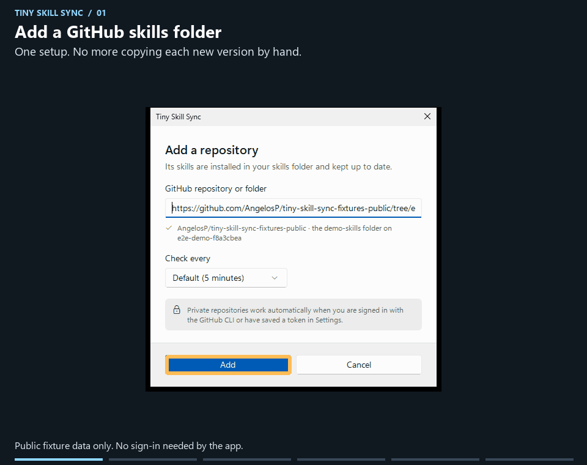

# Tiny Skill Sync App

**Keep your Copilot skills, agents, instructions and CLI plugins up to date.**

Paste one GitHub location: a repository, a branch or a folder in it. The app finds the skills, agents,
instructions and plugins there and shows them before anything is saved.
This small Windows tray app checks on a schedule, updates unchanged copies and holds files with your edits.
You decide what happens next.



*Real app, throwaway demo data. The five-minute scheduled wait is shortened.
[Read the demo as text](#what-the-demo-shows).*

## Why use it?

- **Set it up once.** Follow several repositories without downloading each new version yourself.
- **Keep your edits.** Review differences in the window before choosing GitHub's version or keeping yours.
- **Keep your own files.** Files you add to a skill stay yours; the app does not list them as changes.
- **Stay out of the way.** It lives in the tray, can start with Windows, and does no work between checks.
  The tray exe is about 1.6 MiB; [measured idle memory is about 1 MiB](docs/GUIDE.md#measured-cost).

## Get started

Windows 10 or 11, x64. No runtime or installer is needed. The exes are not signed.

1. Download the Windows zip from [Releases](https://github.com/AngelosP/tiny-skill-sync/releases).
   Extract both exes into a folder you want to keep.
2. Start `tiny-skill-sync.exe` and click its tray icon.
3. Click **Add source** and paste `owner/name`, a repository address, or the address of a branch or folder.
   For example:

   ```text
   https://github.com/anthropics/skills/tree/main/skills
   ```

4. Click **Preview** to see what was found, grouped by type, and where it will go. **Cancel** saves and installs
   nothing. **Add and check** saves the source and starts the first check. The default interval is one day.
   When the location has plugins, choose **Add without approving plugins** or **Add and approve these plugins**.

Public repositories need no sign-in. For private ones, sign in with `gh auth login` or save a read-only token
in the app's Settings. See [private repositories](docs/GUIDE.md#private-repositories).

## How it works

One source can hold four types of content, found at any depth below the location you gave:

- **Skills**, folders containing `SKILL.md`, copied into `%USERPROFILE%\.copilot\skills`, where Copilot looks
  for user-level skills.
- **Agents**, `*.agent.md` files, and **Instructions**, `*.instructions.md` files, copied into the matching
  `agents` and `instructions` folders.
- **Plugins**, installed by GitHub Copilot CLI from a marketplace at the root of the branch, only after you approve
  them. Plugins can run programs. New plugins, a new publisher and a new branch wait for approval on each PC.
  This does not drive VS Code's plugin installer. See
  [Plugins for GitHub Copilot CLI](docs/GUIDE.md#plugins-for-github-copilot-cli).

A plugin or skill owns everything inside it, so its bundled parts are never synced on their own. Each type can be
turned off in Settings or for one source. Folders such as `tests` and `examples`, and the skills and agents in a
repository's own `.github` or `.claude` folders, are skipped by default; the preview says what was skipped.
See [What a source finds](docs/GUIDE.md#what-a-source-finds). The app can reuse an existing repo-named folder
without duplicating its files; it adopts only copies that match.

On each scheduled check, it installs new skills and updates copies you have not edited. When GitHub removes a skill,
only its proven upstream files are removed; your added files stay. A network failure never counts as a deletion.
If the whole listing becomes empty, the app asks first.

Edits are held for your choice. **Show changes** compares your copy with GitHub. If either copy changes
after the comparison, open **Show changes** again before confirming.
**Use the GitHub version** keeps the replaced copy as a backup; **Keep my version** stops managing that skill.
Existing copies are adopted only after a complete match with a current or past upstream version.
Skill downloads are copied, never run.

[Read the full safety promises](docs/GUIDE.md#safety-promises), including
[which text differences count as edits](docs/GUIDE.md#what-counts-as-the-same).

### What the demo shows

1. Add a public repository's skills folder.
2. Its skills appear in the app and are verified on disk in an isolated copy of the Copilot skills folder.
3. Change a file on GitHub and let the next scheduled check install it. The five-minute wait is cut from the GIF.
4. Edit a managed file locally. An upstream update is held, and **Show changes** explains the difference.
5. Choose **Keep my version**. That skill stays yours and the other skills stay in sync. The healthy tray icon is
   now solid green; the demo shows the earlier blue icon in an enlarged illustration.

## More

- [User guide](docs/GUIDE.md): the window, command line (`tss`), backups, settings, updating the app and limitations.
- [Measured cost](docs/GUIDE.md#measured-cost): timings, memory, disk use and test conditions.
- [Contributing](CONTRIBUTING.md): build, test and remake the demo.
- [Architecture](ARCHITECTURE.md): how the safety rules work inside.

**Updating the app is separate from syncing skills.** Copies with the updater can check the official stable
release and replace both exes in their existing folder. Use **Settings → App updates** or `tss update check`.
After an immediate install the tray restarts into the update; an install at Quit leaves it closed, and
`tss update install` changes only the files. Copies without the updater (including 0.6.0) need one
[manual upgrade](docs/GUIDE.md#updating-the-app).
Whether an already-running Copilot session reloads changed skills without restarting has not been verified.

### Run from a shared folder

You can keep both exes in a NAS or OneDrive folder and use `tss portable` to export the current repositories and
settings into two companion JSON files beside them. Each machine keeps its own state, token and Copilot folders.
Update every copy before sharing: older versions cannot read the current source format.
Read [the shared-folder notes](docs/GUIDE.md#run-from-a-shared-folder) before using this mode.
